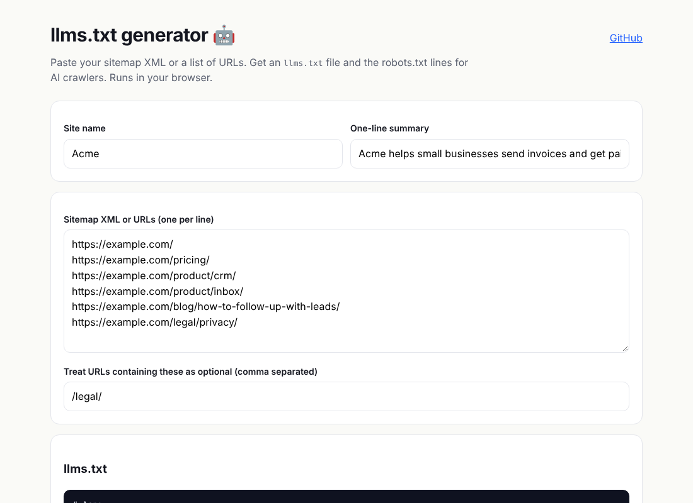

# llms.txt generator 🤖

**Make your site easier for AI assistants to read.** Paste your sitemap XML (or a list of URLs) and get a ready-to-upload `llms.txt`, grouped by section, plus `robots.txt` rules for the main AI crawlers (GPTBot, OAI-SearchBot, ClaudeBot, PerplexityBot, Google-Extended and more).

✨ **Try it:** https://tiwalade-joanna-okedara.github.io/llms-txt-generator/



## Why

Part of my job is getting brands to show up correctly in ChatGPT, Perplexity and Google's AI answers. Two quick wins come up every time: give models a clean map of your important pages, and make sure you're not accidentally blocking the bots that cite you. This does both in one page.

## Use it in code

```js
const { parseUrls, buildLlmsTxt } = require('./llms.js');
buildLlmsTxt({ name: 'Acme', summary: 'What Acme does.', urls: parseUrls(sitemapXml) });
```

Crawler user-agent names change. Check each vendor's docs before blocking anything.

---
Made by [Tiwalade Joanna Okedara-Kalu](https://github.com/tiwalade-joanna-okedara) · MIT licence
